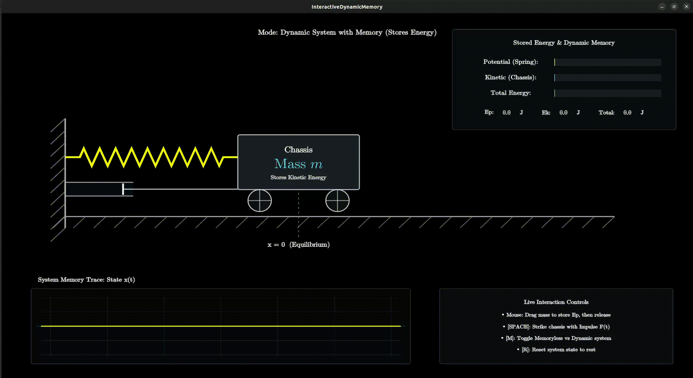

# Mass-Spring-Damper Simulation & Dynamic Memory (ManimGL)

An interactive, 3Blue1Brown-style physics sandbox demonstrating the concept of **Dynamic Memory in Physical Systems** using a mass-spring-damper mechanical oscillator.

Built with [ManimGL](https://github.com/3b1b/manim) (OpenGL-accelerated Manim) featuring real-time state waveform traces (oscilloscope), an energy accounting HUD ($E_p$, $E_k$, $E_{\text{total}}$), and interactive keyboard/mouse controls.

<p align="center">
  
</p>

---

## Key Features

- **Real-Time Physics Simulation**: Numerical integration of second-order damped harmonic motion with real-time mouse interaction and impulse forces.
- **Dynamic Memory vs. Memoryless Modes**: Switch on the fly between dynamic systems with state memory (retaining energy in mass and spring) and static/memoryless systems.
- **Live Energy Accounting HUD**: Real-time measurement of Potential Energy ($E_p$), Kinetic Energy ($E_k$), and Total Energy ($E_{\text{total}}$).
- **Rolling Oscilloscope Waveform**: Visualizes past state history $x(t)$, illustrating how the physical state encodes past inputs over time.
- **Zero LaTeX Installation Required**: Mathematical formulas use Donald Knuth's authentic Computer Modern typography generated on-the-fly via Matplotlib mathtext SVG paths. You do **not** need a multi-gigabyte TeXLive / LaTeX installation.

---

## Prerequisites (System Libraries)

ManimGL requires **FFmpeg** and standard **OpenGL** libraries for rendering:

### Ubuntu / Debian
```bash
sudo apt update && sudo apt install -y \
    ffmpeg \
    libgl1-mesa-dev \
    mesa-utils \
    libpango1.0-dev \
    libcairo2-dev \
    pkg-config
```

### macOS (Homebrew)
```bash
brew install ffmpeg
```

### Windows
Install [FFmpeg](https://ffmpeg.org/download.html) (e.g. via `winget install Gyan.FFmpeg` or Chocolatey) and ensure `ffmpeg` is accessible in your system `PATH`.

---

## Quickstart

### Option A: Using `uv` (Fastest, Recommended)

If you have [`uv`](https://docs.astral.sh/uv/) installed:

```bash
# 1. Clone the repository
git clone https://github.com/Mohammed159159/mass_spring_damper_manimgl.git
cd mass_spring_damper_manimgl

# 2. Run interactively (uv automatically manages the environment and dependencies)
uv run manimgl src/dynamic_memory.py InteractiveDynamicMemory
```

### Option B: Using Standard Python `venv` + `pip`

```bash
# 1. Clone the repository
git clone https://github.com/Mohammed159159/mass_spring_damper_manimgl.git
cd mass_spring_damper_manimgl

# 2. Create and activate a virtual environment (Python >= 3.10)
python3 -m venv .venv
source .venv/bin/activate   # On Windows: .venv\Scripts\activate

# 3. Install dependencies
pip install -r requirements.txt

# 4. Launch the interactive window
manimgl src/dynamic_memory.py InteractiveDynamicMemory
```

> **Convenience Script**: On Linux and macOS, you can also launch the simulation directly with:
> ```bash
> ./interactive_dynamic_memory.sh
> ```

---

## Interactive Controls

Once the OpenGL window launches, interact with the physical system directly:

| Input | Action | Physical Interpretation |
| :--- | :--- | :--- |
| **Mouse Click & Drag** | Displace the Chassis | Displaces the mass, storing potential energy $E_p$ in the spring. Release to initiate oscillation. |
| **`[SPACE]`** | Apply Impulse Force | Delivers an instantaneous force kick $\delta(t)$ to the mass ($E_k$ spike). |
| **`[S]`** | Toggle Continuous Step Force | Toggles continuous constant external force $F_{\text{ext}}$. |
| **`[M]`** | Toggle System Mode | Toggles between **Dynamic System** (stores energy/memory) and **Memoryless System** ($E = 0$). |
| **`[R]`** | Reset System | Resets chassis position, velocity, and forces back to equilibrium ($x = 0$). |

---

## Exporting Videos & Animations

To render the simulation to a video file instead of opening an interactive window:

```bash
# Render a high-definition 1080p MP4 video (saves to videos/)
uv run manimgl src/dynamic_memory.py InteractiveDynamicMemory -w --hd

# Render an animated GIF
uv run manimgl src/dynamic_memory.py InteractiveDynamicMemory -i
```

---

## Physics & Mathematical Foundation

The mechanical oscillator is modeled by Newton's second law:

$$m \ddot{x}(t) + c \dot{x}(t) + k x(t) = F_{\text{ext}}(t)$$

where:
- **Mass ($m$)**: Inertial element storing kinetic energy:
  $$E_k = \frac{1}{2} m \dot{x}^2$$
- **Spring ($k$)**: Restoring stiffness element storing potential energy:
  $$E_p = \frac{1}{2} k x^2$$
- **Damper ($c$)**: Viscous friction dashpot dissipating energy into heat:
  $$P_{\text{diss}} = c \dot{x}^2$$

### Why Does It Have "Memory"?
In a static/memoryless system, output at time $t$ depends strictly on the current input ($y(t) = f(u(t))$). In dynamic systems, energy storage elements (the mass and spring) retain information about past inputs across time in the state vector:

$$\mathbf{x}(t) = \begin{bmatrix} x(t) \\ \dot{x}(t) \end{bmatrix}$$

This stored energy sustains motion long after an external impulse has ceased, producing the characteristic waveform trace displayed on the oscilloscope.

---

## Repository Structure

```text
mass_spring_damper_manimgl/
├── src/
│   └── dynamic_memory.py          # Main ManimGL interactive simulation scene
├── assets/
│   └── demo.gif                   # Preview GIF used in documentation
├── interactive_dynamic_memory.sh  # Cross-environment launch script
├── pyproject.toml                 # uv / PEP 621 package metadata & dependencies
├── requirements.txt               # Fallback dependency specification for pip
├── .gitignore                     # Git ignore rules for video caches & temp files
└── README.md                      # Project documentation
```

---

## License

MIT License. See [LICENSE](LICENSE) for details.
